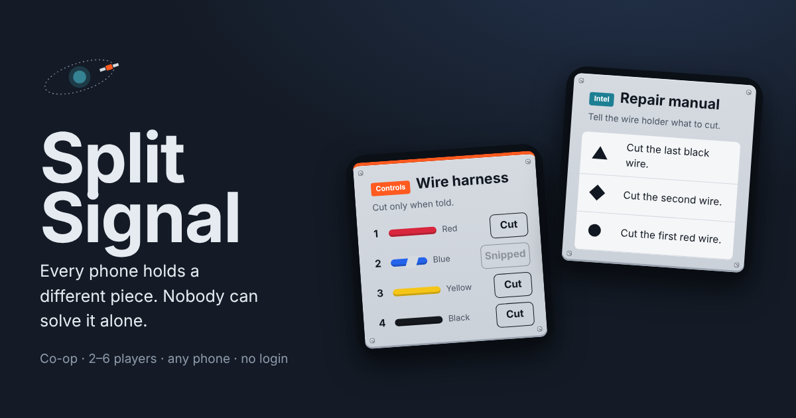

# Split Signal

**A co-op game where every phone holds a different piece of the puzzle.**



A rogue satellite is losing orbit. Your crew joins a room from their phones with a 4-letter code (no login, no install), and every screen shows only a fragment of what's needed: one player holds the controls, others hold the clues. Nobody can solve a module alone, so you have to talk. Five modules, one shared clock. Wrong moves cost a strike and time, and every strike flashes on every phone at once. Run out of time or strikes, and the satellite crashes on everyone's screen together.

2–6 players · 5–8 minutes · same room or on a call · solo practice mode for trying it alone.

## How to play

1. **Every phone gets different pieces.** One player holds the **Controls** (the only place anything can be pressed). Others hold **Intel**. One player holds the **Mission clock**, the only exact view of the time left; everyone else sees the orbit decaying.
2. **Talk.** Describe what you see. The controller acts on what the crew tells them.
3. **Five modules, one clock.** Clearing a module adds time. A wrong move is a strike and costs time.
4. **Pieces reshuffle** after every module, so everyone takes a turn at the controls.

| Module | Controls | Intel | Intel |
| --- | --- | --- | --- |
| Wire harness | Colored wires with cut buttons | Serial tag (one symbol) | Repair manual (symbol → which wire to cut) |
| Glyph keypad | Four glyph buttons | Status beacon (a color) | Glyph columns (one per color, in press order) |
| Frequency dial | Dial 0–15 and a lock | Beacon signal (color + shape) | Frequency chart (color × shape grid) |
| Uplink code | Number keypad | Code fragments (digit per colored chip) | Fragment order (color sequence) |
| Power switches | Five switches A–E | Target load | Switch ratings (what each switch adds) |

Difficulty: **Cadet** (5 minutes, 4 strikes) or **Commander** (about 3 minutes, 3 strikes, bigger penalties). Every color is also written out in words, so colorblind players can play every role.

## How it works

Split Signal is a static site with no backend.

- **The host's browser is the game server.** It holds the only copy of the state, generates the puzzles, runs the clock, and sends each player only the pieces they hold. Answers never leave the host.
- **Players connect peer-to-peer** over WebRTC data channels with [PeerJS](https://peerjs.com); its public broker only introduces the devices.
- **Roles are dealt per module.** The control piece rotates so the same player rarely controls twice in a row. Two players: one controls, the other holds every clue. Five or six: extra players get backup copies of intel.
- **Resilient:** a refreshing or dropped player rejoins the same seat; their pieces move to someone present while they're gone. A refreshing host reopens the same room and everyone reconnects.

```
index.html        page shell
css/style.css     all styles
js/puzzles.js     the five module generators and piece descriptions
js/engine.js      roles, clock, strikes, flow (pure, no DOM or network)
js/pieces.js      hardware-panel rendering for every piece
js/net.js         PeerJS host/client networking with heartbeats and retries
js/app.js         screens, host loop, client connection
tests/            engine tests and a 3-tab end-to-end mission
```

## Run locally

```bash
npx serve .            # or: python3 -m http.server 5174
```

Create a room, open the invite link in a second tab or on your phone, and launch. Launch alone for solo practice.

## Tests

```bash
npm test               # engine: 300 random puzzles per module checked solvable from intel, roles, strikes, crash, reconnects, full missions
```

End-to-end (3 tabs fly a full mission, a synced strike and crash, plus a solo run; uses `tests/fake-peer.js` so it runs offline):

```bash
npm i -D playwright && npx playwright install chromium
python3 -m http.server 5174 &
node tests/e2e.mjs
```

## Deploy to Netlify

Import this repository in Netlify, leave the build command empty and publish `.` (set in `netlify.toml`). Every push to `main` redeploys.

## Notes

- The host keeps their tab open; the mission runs on their device.
- Very restrictive networks can block peer-to-peer connections; switching one device to mobile data usually fixes it.
